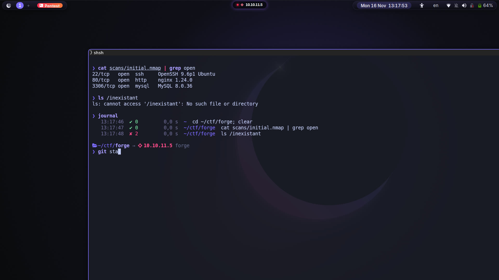
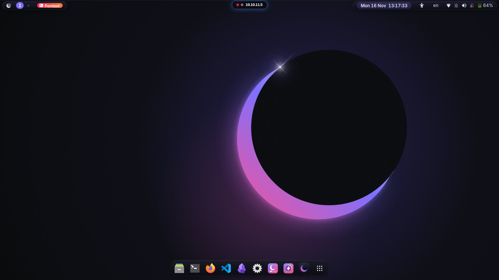
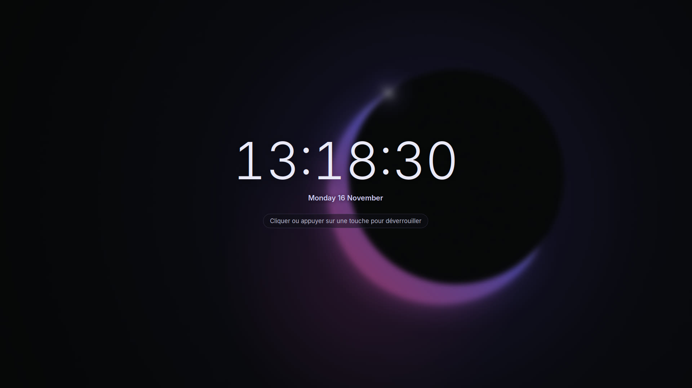
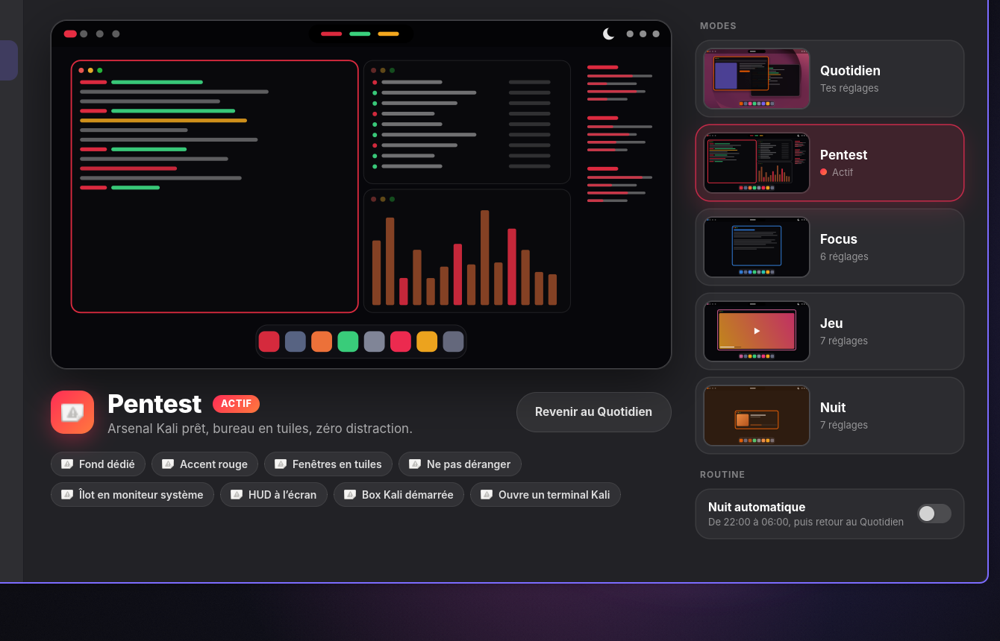
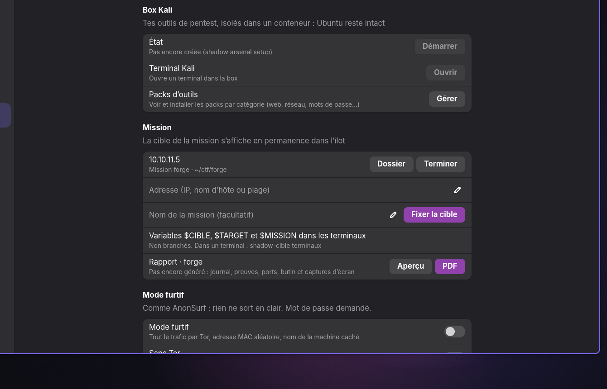
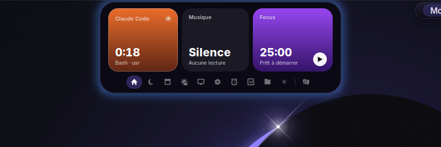
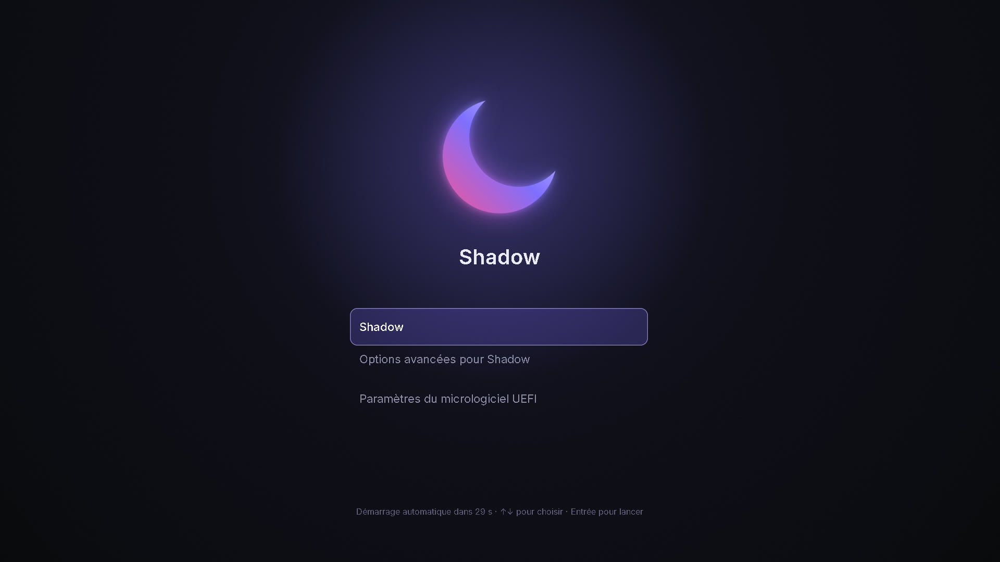
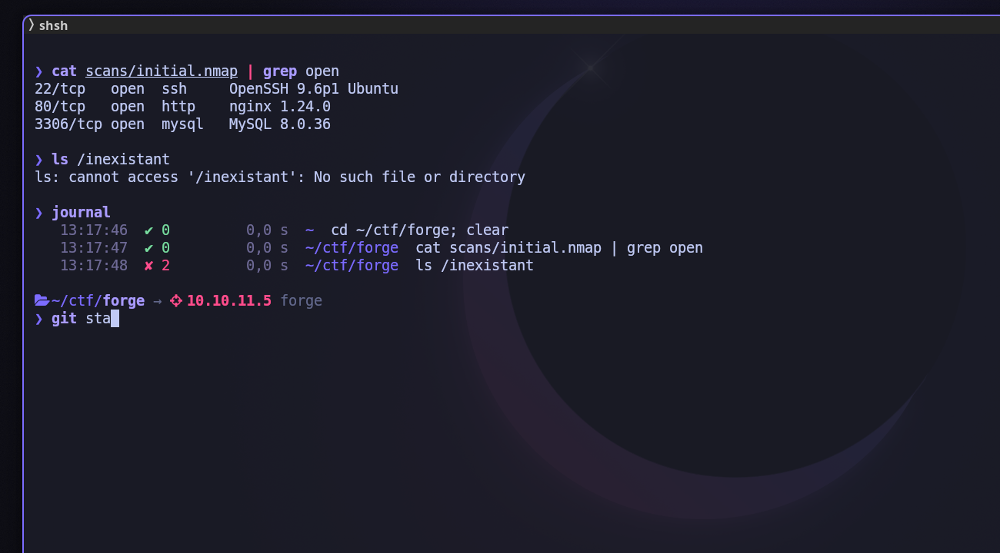
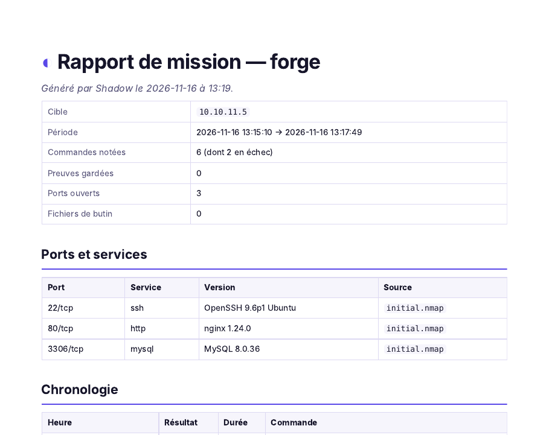

<div align="center">

# ◐ Shadow OS

**Un bureau qui ressemble à macOS, se pilote au clavier comme un gestionnaire en tuiles, et embarque la boîte à outils d'un pentesteur.**

Basé sur Ubuntu 26.04 et GNOME 50 · identité « Éclipse » · interface en français

[English](README.md) · [Licence : GPL-3.0](LICENSE) · [shsh, le shell de Shadow](https://github.com/jordanwinner/shsh)



</div>

## Pourquoi Shadow

Les distributions de pentest donnent des centaines d'outils et un bureau dans lequel personne ne choisirait de vivre. Les bureaux soignés sont beaux mais ne savent rien de ta mission. Shadow est les deux : un bureau qu'on a envie d'utiliser tous les jours, où **la mission en cours traverse tout le système**.

Une seule commande pour fixer la cible :

```sh
shadow cible 10.10.11.5 forge
```

et elle apparaît dans l'îlot dynamique, dans le prompt de chaque terminal, dans `$CIBLE` / `$TARGET` / `$MISSION`, dans un dossier `~/ctf/forge`, dans un journal de commandes automatique, puis dans un rapport PDF.

## Les points forts

| | |
|---|---|
| **Mission** | Cible partagée par l'îlot, le prompt et l'environnement · journal automatique des commandes · `preuve COMMANDE` garde la sortie nettoyée comme preuve · `shadow rapport --pdf` produit le rapport (chronologie, ports ouverts tirés de nmap, butin avec SHA-256, captures prises pendant la mission). Les textes venus de la cible sont neutralisés : une bannière piégée ne peut rien exécuter dans le rapport. |
| **Arsenal isolé** | Les outils Kali dans un conteneur sans root (distrobox + podman) : 14 lots d'outils, rangés dans la grille, sans jamais toucher au système. |
| **Mode furtif** | `shadow furtif on` : tout le trafic par une instance Tor dédiée, avec coupe-circuit nftables (DNS compris, rien ne sort en clair), adresse MAC aléatoire, nom de la machine caché au DHCP. La sortie par Tor est vérifiée, sinon tout est annulé automatiquement. `--sans-tor` garde le VPN des CTF. |
| **Îlot dynamique** | Musique, notifications, minuteur de concentration, activités en direct (cible de mission, mises à jour), accès rapide aux modes. |
| **Modes** | Quotidien, Pentest, Focus, Jeu, Nuit : fond, accent, tuiles, ne pas déranger, énergie et box Kali d'un seul geste, avec aperçus. Routine « Nuit automatique ». |
| **Flottant ⇄ tuiles** | Fenêtres libres façon macOS ou rangées en tuiles, avec `Super+T`. |
| **Centre Shadow** | Une seule appli de réglages : modes, énergie, apparence, arsenal, mission, rapport, mode furtif. |
| **Entretien automatique** | `shadow maj` met à jour apt, snap, Flatpak, les extensions GNOME, la box Kali et shsh avec un seul mot de passe, après un instantané léger (`shadow maj retour` revient en arrière). Les mises à jour en attente s'affichent dans l'îlot. `shadow docteur` vérifie le bureau toutes les 15 minutes et répare ce qui peut l'être sans risque. |
| **Une vraie session** | Une session « Shadow » à l'écran de connexion : les extensions de Shadow font partie du mode de GNOME Shell et ne peuvent plus être coupées en bloc. |
| **Identité Éclipse** | Thèmes du shell et GTK, écran de verrouillage, menu GRUB, animation de démarrage et d'extinction, icônes, thèmes VS Code et Obsidian. |

## Captures

| | |
|---|---|
|  |  |
| Bureau : barre en pilules, dock en verre, pastille de mode | Écran de verrouillage |
|  |  |
| Modes avec aperçus | Arsenal : box Kali, mission, rapport, mode furtif |
|  |  |
| Îlot dynamique ouvert | Menu de démarrage |
|  |  |
| shsh pendant une mission | Rapport de mission généré |

> **État :** Shadow est un projet personnel en développement actif, utilisé au quotidien sur une machine. Une ISO installable est prévue. Certaines pièces (l'îlot dynamique, la commande `shadow` et les scripts de l'arsenal) vivent pour l'instant dans un dépôt séparé, `shadow-desktop`, pas encore public.

## Identité « Éclipse »

Un disque d'ombre passe devant la lumière : il ne reste qu'un croissant.

| Rôle | Nom | Valeur |
|---|---|---|
| Fond | Vide | `#07070B` |
| Surface | Encre | `#0E0E16` |
| Surface haute | Ardoise | `#1A1A30` |
| Accent | Éclipse | `#7C6CFF` |
| Accent clair | Aura | `#D9D2FF` |
| Secondaire | Braise | `#FF4D8D` |

- `identite/logo.svg` : icône (squircle)
- `identite/fond-eclipse.svg` : fond d'écran 3200×1800
- `scripts/rendre-svg.sh` : rendu SVG → PNG via Chrome headless
- les PNG se régénèrent dans `identite/rendus/` (non versionnés)

## Installation

Pour (ré)appliquer Shadow sur une machine Ubuntu/Debian + GNOME :

```bash
./installer.sh              # modules utilisateur (extensions, thème, grille, scripts, terminal, apps)
./installer.sh --avec-shell # + shsh, le shell de Shadow (dépôt ~/Dev/shsh : mission et mode dans le prompt)
./installer.sh --tout       # + shell, système (GRUB/Plymouth/login), arsenal Kali, bureau shadow-desktop
./installer.sh --simuler --tout   # montre le plan sans rien modifier
./installer.sh --liste      # liste les modules
```

L'installateur télécharge les extensions GNOME tierces depuis extensions.gnome.org
selon la version du shell, lie l'extension Shadow, applique le thème et la grille,
installe les scripts, le terminal et les apps. Idempotent : relançable sans risque.

### Paquets Debian

```bash
paquet/construire.sh            # produit paquet/sortie/shadow-os*_1.0.0_all.deb
sudo apt install ./paquet/sortie/shadow-os_1.0.0_all.deb   # méta : bureau + dépendances
shadow-os                       # active Shadow sur le compte (puis reconnexion)
shadow-os --revert              # revient au bureau d'avant
```

- `shadow-os-desktop` : charge utile dans `/usr/share/shadow-os` + commande `shadow-os`.
- `shadow-os` : méta-paquet qui tire le bureau et toutes les dépendances
  (GNOME Shell, gestionnaire d'extensions, polices, terminal ; distrobox/podman en recommandés).

### Dépôt APT

```bash
depot/construire-depot.sh       # construit depot/sortie/ (pool + dists signés + clé publique)
sudo depot/ajouter-depot.sh "file:$PWD/depot/sortie"   # ajoute le dépôt (local)
sudo apt update && sudo apt install shadow-os
```

Le dépôt est signé par une clé GPG dédiée (trousseau local `depot/.gnupg`, jamais
le trousseau personnel). Pour publier sur une URL (GitHub Pages, serveur) : copier
`depot/sortie/` à la racine web, puis sur chaque machine :
`sudo depot/ajouter-depot.sh "https://<domaine>/shadow"`. La clé publique est
`depot/sortie/shadow-os-archive-keyring.gpg`.

## Commandes

| Commande | Effet |
|---|---|
| `Super+T` ou `shadow mode bascule` | flottant (macOS) ⇄ tuiles (Omarchy) |
| `shadow arsenal setup` | crée la box Kali isolée (distrobox + podman, sans toucher à Ubuntu) |
| `shadow arsenal install <pack>` | installe un pack d'outils Kali (web, recon, reverse, passwords…) |
| `shadow arsenal export <appli>` | ajoute une appli Kali à la grille (dossier « Arsenal ») |
| `shadow maj` | met tout à jour avec un seul mot de passe : apt, snap, Flatpak, extensions GNOME (styles refusionnés), arsenal Kali, shsh |
| `shadow maj instantanes` / `retour [ID]` | avant chaque mise à jour : versions des paquets, `/etc`, révisions snap et paquets actuels gardés (3 derniers, `/var/lib/shadow-os/instantanes`) ; `retour` réinstalle les versions d'avant et ramène les snaps |
| `shadow maj verifier` | montre ce qui attend une mise à jour, sans rien changer |
| `shadow docteur` / `reparer` | vérifie extensions, barre, thème, commandes, shsh, système, mission, arsenal ; répare ce qui peut l'être. Passe seul toutes les 15 min (`shadow docteur minuteur on`) : répare sans risque, prévient dans l'îlot pour le reste |
| `shadow cible ADRESSE NOM` / `fin` | mission : îlot, `$CIBLE` dans les terminaux, dossier `~/ctf/NOM` ; shsh y tient `journal.md` |
| `shadow rapport [NOM] [--pdf]` | rapport Markdown de la mission : chronologie (journal shsh), preuves (`preuve COMMANDE` dans shsh), ports nmap de `scans/`, butin avec SHA-256, captures d'écran prises pendant la mission (copiées dans `captures/`), notes ; `--pdf` ajoute `rapport.html` et `rapport.pdf` (Chrome headless). Aussi dans le Centre : page Arsenal › Mission › Aperçu / PDF |
| îlot : pastille « N mises à jour » | `shadow maj veille` (minuteur 6 h) compte ce qui attend ; toucher la pastille ou la tuile « Mises à jour » de l'accueil lance `shadow maj` dans un terminal |
| `shadow mode restaurer` | remet les réglages d'avant le premier `shadow mode` |
| `theme/eclipse.sh apply` | palette Éclipse : thème shell + GTK « Shadow », tuiles, dock |
| `theme/eclipse.sh revert` | revient au thème d'avant (TokyoCombo / Tokyonight) |
| `theme/eclipse.sh build` | régénère les thèmes après une mise à jour de GNOME |
| `theme/applis.py apply` / `revert` / `check` | grille en dossiers, noms courts, doublons masqués, dock court |
| `theme/icones.sh apply` / `revert` | thème d'icônes Shadow (Papirus-Dark, dossiers violets) |
| `sudo systeme/installer-systeme.sh` | GRUB Éclipse, animation de démarrage, écran de connexion, nom « Shadow » |
| `sudo systeme/desinstaller-systeme.sh` | annule la partie système (sauvegardes dans `/var/backups/shadow-os`) |

Applis :
- `apps/vscode/` : thème VS Code « Shadow Éclipse » (`code --install-extension apps/vscode/shadow-eclipse-1.0.0.vsix`)
- `apps/obsidian/shadow-eclipse.css` : extrait CSS à copier dans `<coffre>/.obsidian/snippets/`
- `apps/bienvenue/bienvenue.py` : présentation au premier démarrage (Utilitaires › Bienvenue)
- `ulauncher/shadow-eclipse/` : thème Ulauncher
- Alt+Espace : recherche GNOME façon Spotlight (extension `shadow-os@jordan`)

Terminal : profil GNOME Terminal « Shadow · Éclipse » + `terminal/fastfetch.jsonc`
(ancienne config : `~/.config/backup-theme/fastfetch-config-avant-shadow.jsonc`).
Extension `extension/shadow-os@jordan` : accent Éclipse sur les tuiles des réglages rapides.

Sauvegardes : `~/.local/state/shadow-os/`, `~/.config/backup-theme/fond-avant-eclipse.txt`.

## Limites connues

- GNOME 50 impose l'accent système aux tuiles des réglages rapides (aucun CSS n'y peut rien) :
  corrigé par l'extension `shadow-os@jordan`, active après reconnexion.
- `shadow theme apply` (ancien shadow-desktop) remettrait Tokyonight : utiliser `eclipse.sh`.

Nom de paquet prévu : `shadow-os-*` (le paquet Debian `shadow` existe déjà :
c'est celui de `passwd`/`login`).


## Licence

Shadow OS est un logiciel libre, publié sous la [licence publique générale GNU v3.0](LICENSE). Il s'appuie sur Ubuntu et GNOME ; Ubuntu est une marque de Canonical Ltd., et Shadow n'est ni affilié à Canonical ni approuvé par elle.
