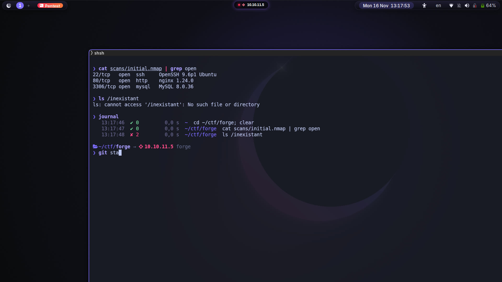
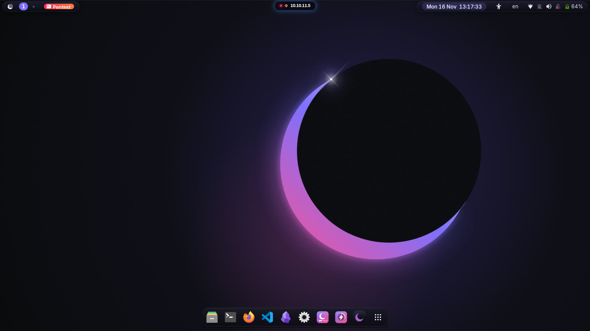
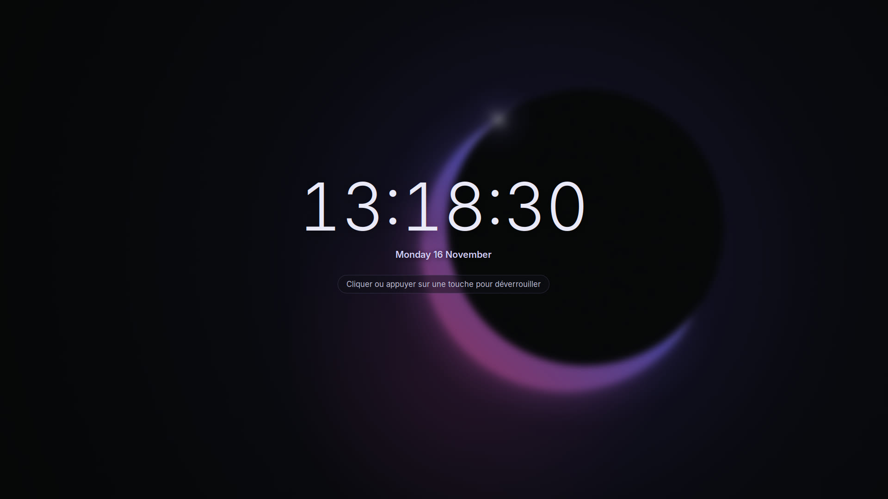
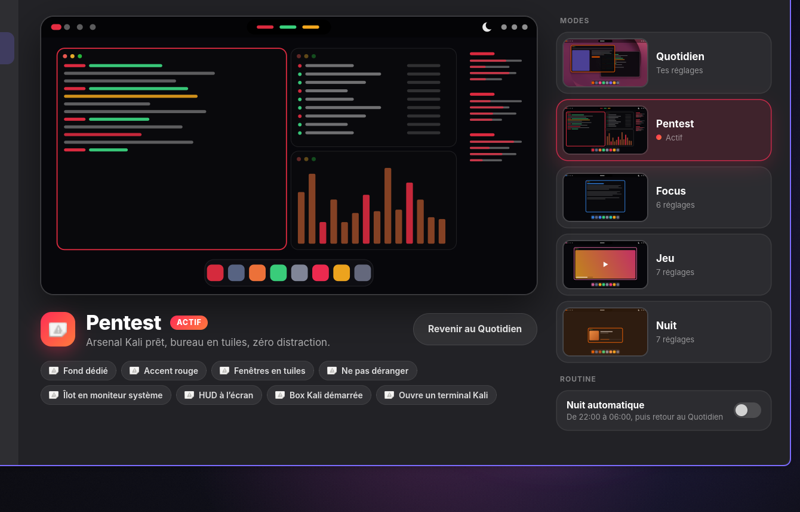
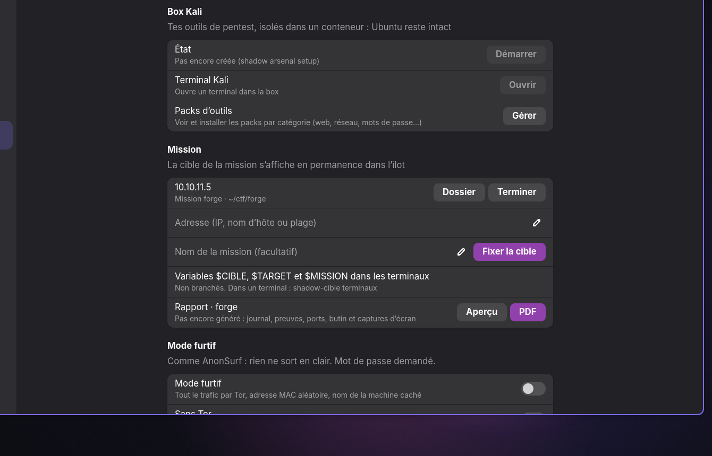
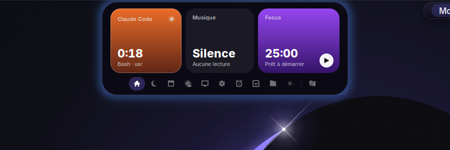
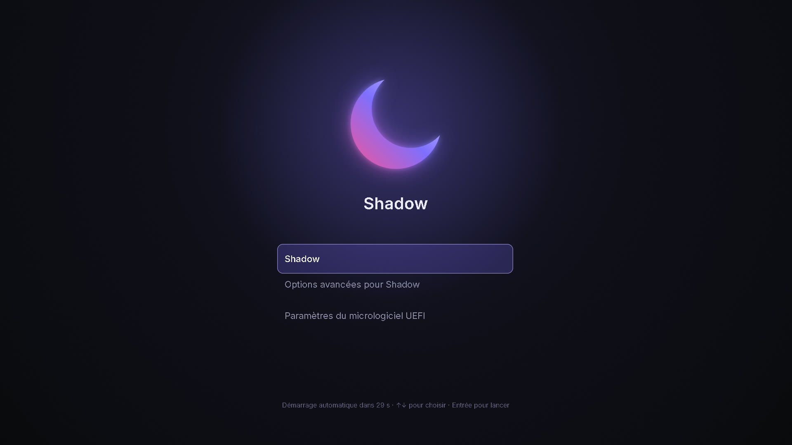
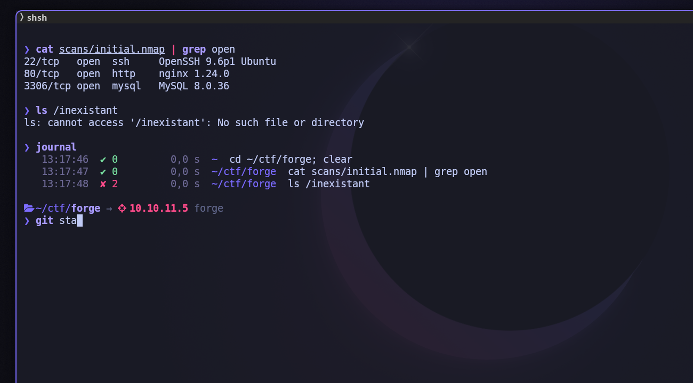
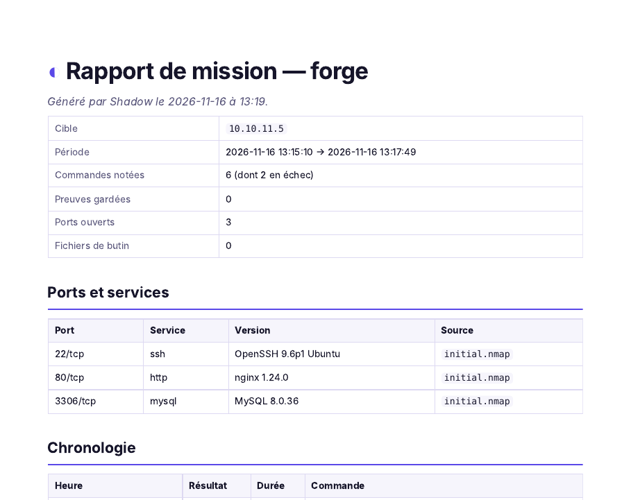

<div align="center">

# ◐ Shadow OS

**A desktop that looks like macOS, drives like a tiling window manager, and carries a pentester's toolkit.**

Built on Ubuntu 26.04 and GNOME 50 · Éclipse identity · French interface

[Français](README.fr.md) · [License: GPL-3.0](LICENSE) · [shsh, the Shadow shell](https://github.com/jordanwinner/shsh)



</div>

## Why Shadow

Pentest distributions hand you hundreds of tools and a desktop nobody would choose to live in. Polished desktops look great and know nothing about your engagement. Shadow is both: a desktop you want to use every day, where **the mission you are working on runs through the whole system**.

Set a target once:

```sh
shadow cible 10.10.11.5 forge
```

and it shows up in the Dynamic Island, in every terminal prompt, in `$CIBLE` / `$TARGET` / `$MISSION`, in a `~/ctf/forge` workspace, in an automatic command journal, and finally in a PDF report.

## Highlights

| | |
|---|---|
| **Mission workflow** | Target shared by the island, the prompt and the environment · automatic command journal · `preuve COMMAND` keeps clean command output as evidence · `shadow rapport --pdf` builds the report (timeline, open ports from nmap, loot with SHA-256, screenshots taken during the mission). Text coming from the target is sanitised: a malicious banner cannot run code in the report. |
| **Isolated arsenal** | Kali tools in a rootless container (distrobox + podman): 14 tool packs, exported to the app grid, never touching the host. |
| **Stealth mode** | `shadow furtif on`: all traffic through a dedicated Tor instance with an nftables kill switch (DNS included, nothing leaves in clear), random MAC address, hostname hidden from DHCP. Tor output is verified, and everything is rolled back automatically if it cannot be confirmed. `--sans-tor` keeps CTF VPNs working. |
| **Dynamic Island** | Media, notifications, focus timer, live activities (mission target, updates in progress), quick access to modes. |
| **Modes** | Everyday, Pentest, Focus, Game, Night: wallpaper, accent, tiling, do-not-disturb, power profile and Kali box in one switch, with live previews. Automatic night routine. |
| **Floating ⇄ tiling** | macOS-style floating windows or tiling, toggled with `Super+T`. |
| **Shadow Centre** | One settings app for modes, power, appearance, arsenal, mission, report and stealth mode. |
| **Self-maintaining** | `shadow maj` updates apt, snap, Flatpak, GNOME extensions, the Kali box and shsh with a single password, after taking a lightweight snapshot (`shadow maj retour` rolls back). Pending updates appear in the island. `shadow docteur` checks the desktop every 15 minutes and repairs what is safe to repair. |
| **A real session** | A dedicated « Shadow » session at the login screen: Shadow's extensions are part of the GNOME Shell mode, so they cannot be switched off in bulk. |
| **Éclipse identity** | Shell and GTK themes, lock screen, GRUB menu, boot and shutdown animation, icons, VS Code and Obsidian themes. |

## Screenshots

| | |
|---|---|
|  |  |
| Desktop: pill top bar, glass dock, mode badge | Lock screen |
|  |  |
| Modes with live previews | Arsenal: Kali box, mission, report, stealth mode |
|  |  |
| Dynamic Island, expanded | Boot menu |
|  |  |
| shsh during a mission | Generated mission report |

## Installation

> **Status:** Shadow is a personal project under active development, used daily on one machine. An installable ISO is planned. Some components (the Dynamic Island, the `shadow` command and the arsenal scripts) currently live in a separate repository, `shadow-desktop`, which is not public yet.

On Ubuntu 26.04 with GNOME 50:

```sh
git clone https://github.com/jordanwinner/shadow-os ~/Shadow
cd ~/Shadow
./installer.sh --simuler --tout      # show the plan without changing anything
./installer.sh                       # user modules: extensions, theme, grid, scripts, terminal, apps
./installer.sh --avec-shell          # + shsh, the Shadow shell
sudo systeme/installer-systeme.sh    # GRUB, boot animation, login screen, « Shadow » session
```

Then log out and pick **Shadow** at the login screen (gear icon). The Ubuntu session stays available. Everything system-wide is backed up in `/var/backups/shadow-os` and undone by `sudo systeme/desinstaller-systeme.sh`.

Debian packages and a signed APT repository can also be built: see [the French README](README.fr.md#paquets-debian).

## Main commands

| Command | What it does |
|---|---|
| `shadow cible IP NAME` · `fin` | Start / end a mission |
| `shadow rapport [--pdf]` | Mission report (Markdown, HTML, PDF) |
| `shadow arsenal setup` · `install PACK` | Create the Kali box · install a tool pack |
| `shadow furtif on [--sans-tor]` · `off` · `etat` | Stealth mode |
| `shadow modes activer pentest` | Switch mode (also `Super+Shift+M`) |
| `shadow mode bascule` | Floating ⇄ tiling (also `Super+T`) |
| `shadow maj` · `verifier` · `retour` | Update everything · check · roll back |
| `shadow docteur` · `reparer` | Check and repair the desktop |

The full command reference is in [README.fr.md](README.fr.md#commandes).

## Roadmap

- Installable ISO, rebranded and based on the official Ubuntu image
- Shadow installable for any user account (system-wide extensions, default settings)
- Public release of the Dynamic Island and `shadow` command repository

## License

Shadow OS is free software, released under the [GNU General Public License v3.0](LICENSE). It builds on Ubuntu and GNOME; Ubuntu is a trademark of Canonical Ltd., and Shadow is not affiliated with or endorsed by Canonical.
